# Plateau

A working clone of Tableau's core visual analytics workflow, built on a from-scratch
**in-memory columnar database engine** with no analytical dependencies.

Drag a field from the Data pane onto a shelf, pick a mark type, and the engine
computes the aggregation and draws the chart. Dimensions and measures are inferred
automatically, exactly as Tableau does it.

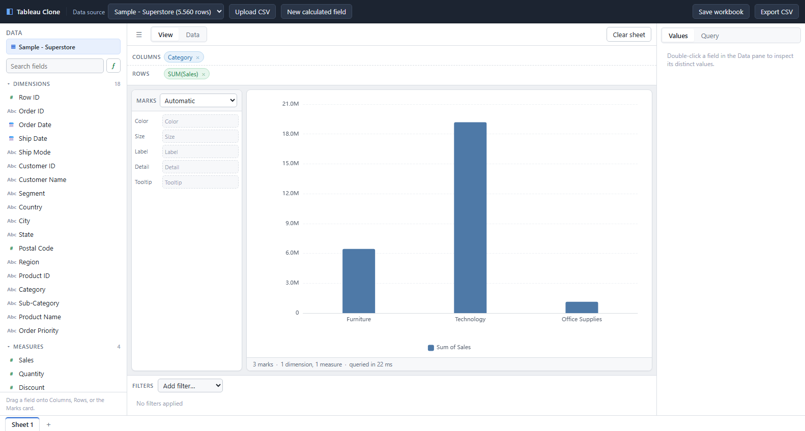

---

## What works

**Data intake**
- CSV/TSV upload through the UI, delimiter sniffing, RFC 4180 quoting, embedded
  newlines, escaped quotes, BOM and CRLF handling
- Automatic type inference: string / integer / real / date / datetime / boolean
- Automatic dimension-vs-measure classification, including identifier detection so
  `Row ID`, `Order ID`, and `Postal Code` are not offered as summable measures
- Bundled 5,560-row Superstore sample, generated deterministically

**Query engine** (the in-memory database)
- Columnar storage with per-column typed arrays and precomputed statistics
- Group-by over any number of dimensions, including date truncation
  (year / quarter / month / week / day)
- Aggregations: `SUM`, `AVG`, `MEDIAN`, `MIN`, `MAX`, `COUNT`, `COUNTD`, `STDEV`,
  `VAR`, `ATTR` — computed in a single pass per group
- Filters: categorical include/exclude, numeric and date ranges, text matching,
  null handling, and measure-scoped Top-N / Bottom-N
- Sorting and row limits, with truncation reported to the UI

**Calculated fields** — a real expression engine
- Full expression language: `IF`/`ELSEIF`/`ELSE`/`END`, `CASE`/`WHEN`/`THEN`,
  arithmetic, comparisons, `AND`/`OR`/`NOT`
- ~60 functions across math, string, date and logical categories
- **Row-level** fields (e.g. `[Profit] / [Sales]`, `YEAR([Order Date])`) materialise
  as real columns
- **Aggregate** fields (e.g. `SUM([Profit]) / SUM([Sales])`) are planned as engine
  aggregation slots, so ratios are computed from group totals rather than averaged
  per row — the correct behaviour, and the one Tableau implements
- Referenced fields are validated, with syntax errors reported before anything commits

**Level-of-detail (LOD) expressions** — `{ FIXED | INCLUDE | EXCLUDE }`

An LOD computes an aggregate at its **own** grouping and attaches the result to every
source row, which is what lets a formula reference a total at a different grain than
the view:

```
{ FIXED   [Region]   : SUM([Sales]) }   group by exactly Region
{ INCLUDE [Customer] : SUM([Sales]) }   the view's dimensions + Customer
{ EXCLUDE [Category] : SUM([Sales]) }   the view's dimensions - Category
{ FIXED              : SUM([Sales]) }   a single grand total
```

This makes share-of-total expressible without a table calculation:

```
SUM([Sales]) / MAX({ FIXED [Region] : SUM([Sales]) })
```

MAX (or MIN/AVG) is the right reduction on the denominator. `SUM` would count each
region's total once per contributing row, which is the trap this feature exists to
make visible — and both behaviours are pinned by tests.

**Filter ordering.** Tableau evaluates LODs partway through the filter pipeline, and
this implementation reproduces the consequence that matters:

| Kind | Sees dimension filters? | Why |
| --- | --- | --- |
| `FIXED` | **No** | Computed before dimension filters run |
| `INCLUDE` / `EXCLUDE` | **Yes** | Computed after dimension filters run |

Measure filters run after aggregation, so no LOD kind sees them. This is verified
end-to-end in the browser, not just in unit tests: with `Category = Furniture` active,
a `FIXED` region total is provably unchanged while an `INCLUDE` value drops.

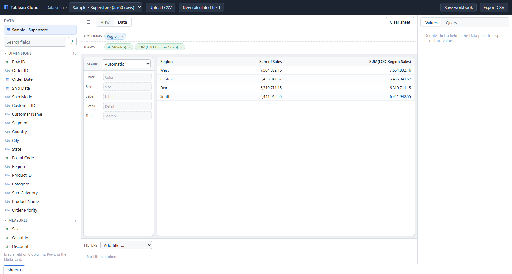

Calculated-field LODs appear in the Data pane like any other measure, and the editor
offers `FIXED` / `INCLUDE` / `EXCLUDE` templates with validation for unbalanced braces
and a missing `:`.

**Visualisation** — 14 mark types
Bar (column/row), line, area, pie, scatter (with trend line), circle, square,
text/crosstab, heat map, treemap, waterfall, and histogram.

### Scatter

Columns supplies x, Rows supplies y. Both axes are named after their field, and a
grouping dimension on Detail (or Color) gives one point per member. A dashed
least-squares trend line is overlaid with its R² in the legend, so the strength of
the relationship is visible rather than implied.

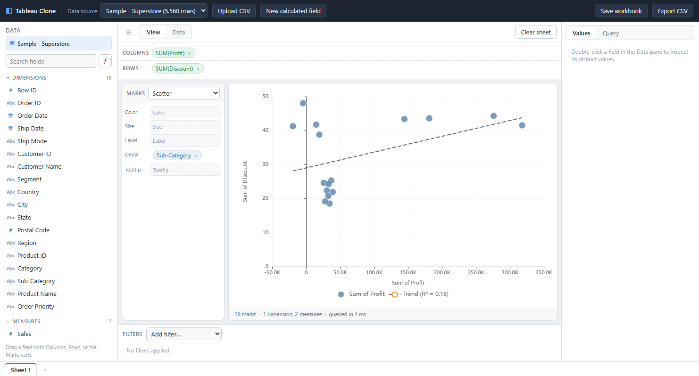

Color splits the points into one series per value while a single trend line still
spans every group:

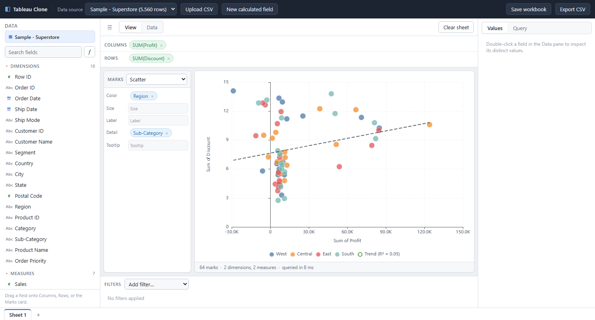

### Heat map

Whatever is on Columns runs across the top and whatever is on Rows runs down the
side; the measure supplies the colour. Both axes are named, the colour scale is
labelled with the measure, values are printed in the cells while the grid stays
legible, and the tooltip names the full group plus the measure.

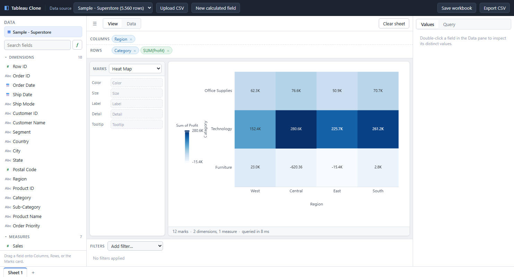

Swapping the shelves swaps the axes, because orientation reads from the shelves
rather than from column order:

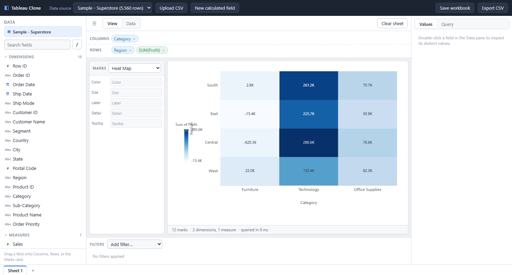

The remaining marks:

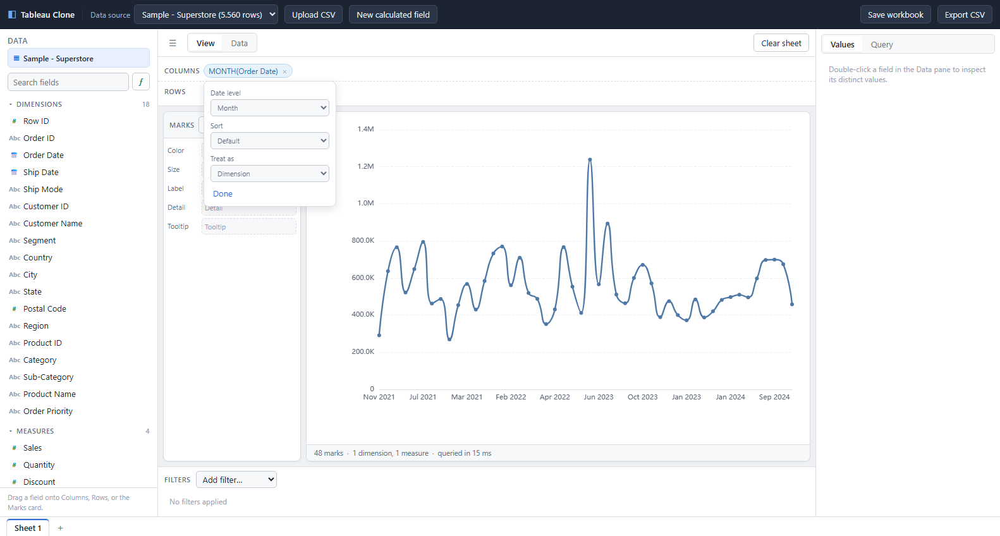
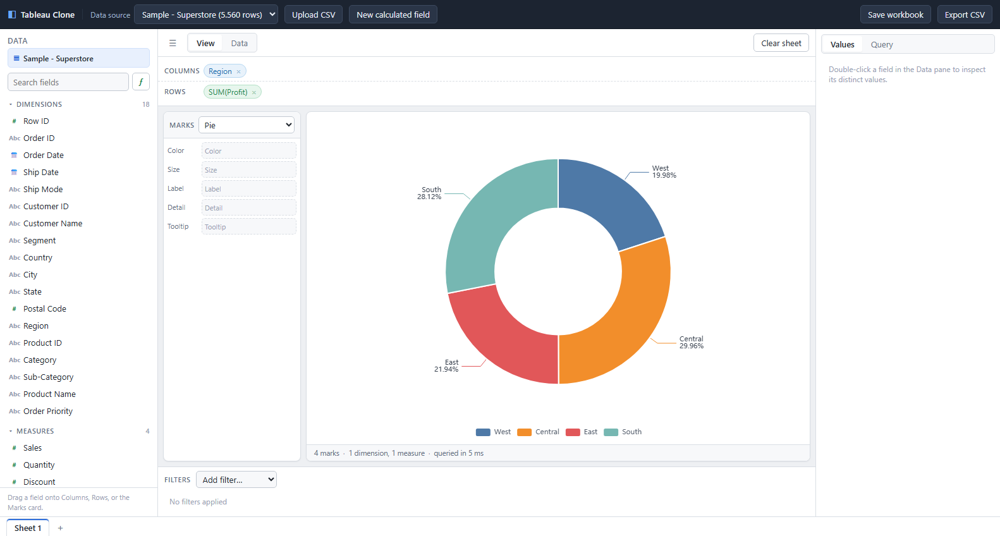
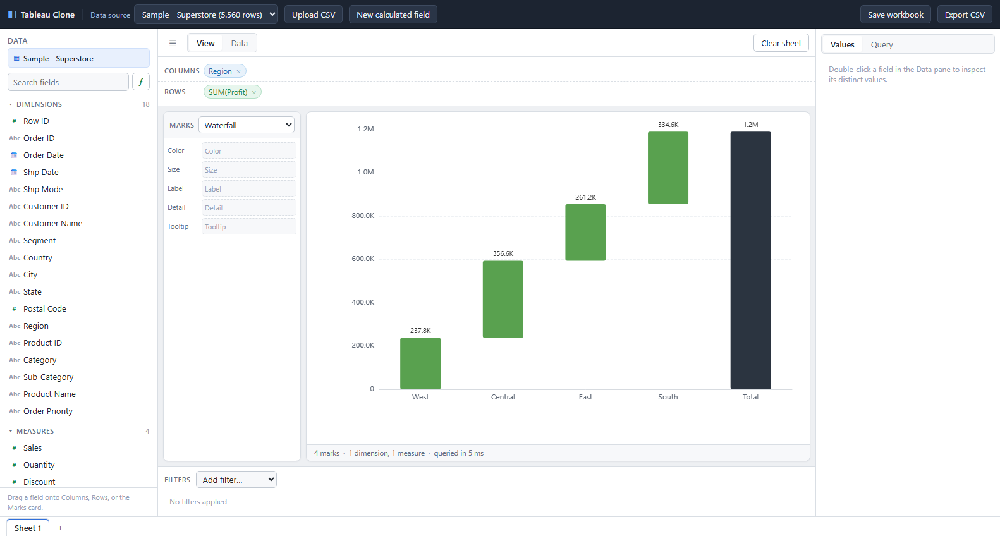

### Sorting

Click any pill to set its **Sort** to Ascending or Descending; that becomes the
engine's `ORDER BY`. For a horizontal bar chart, a descending sort is drawn
**largest at the top**:

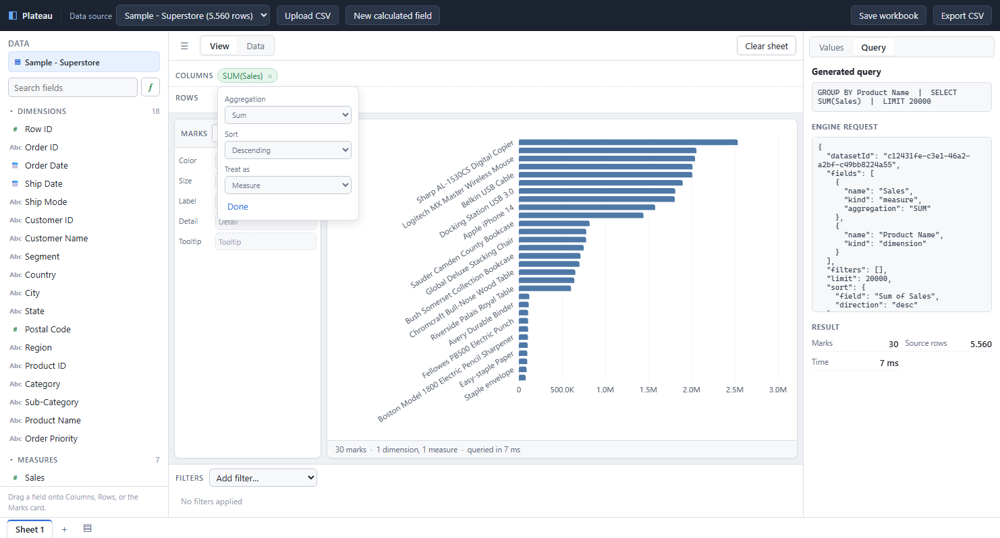

Orientation matters here and is handled explicitly. A category axis runs
bottom-to-top, so without flipping it a descending sort would put the largest bar
at the *bottom*, reading as ascending. The axis is inverted only for horizontal
bars with a descending sort; vertical bars are left alone, where left-to-right
descending already reads correctly.

**Interface**
- Data pane with search, dimension/measure sections, and calculated-field management
- Columns / Rows shelves plus a Marks card (Color, Size, Label, Detail, Tooltip)
- Drag pills between shelves to reorder or re-encode; click a pill to change its
  aggregation, date level, sort, or dimension/measure role
- Filters shelf with value pickers showing row counts
- View / Data tabs, and an inspector showing field statistics or the exact engine
  request that produced the view
- **Dashboards** composing several worksheets on a shared grid (see below)
- Multi-sheet workbook with debounced autosave to `data/workbook.json`, plus an
  explicit **Save workbook** / **Open workbook** pair, a save-state indicator that
  says `Unsaved changes` or `Saved 14:32`, and **Restore backup**, which swaps the
  current file for the previous generation (the server rotates the current one
  aside first, so a restore is itself undoable)
- **Nested category axes**: every placed dimension gets its own indented line in the
  axis label — ECharts has no nested category axis, so the hierarchy lives in the
  label — which is what makes a third dimension visible instead of silently
  grouping the query
- CSV export of any result

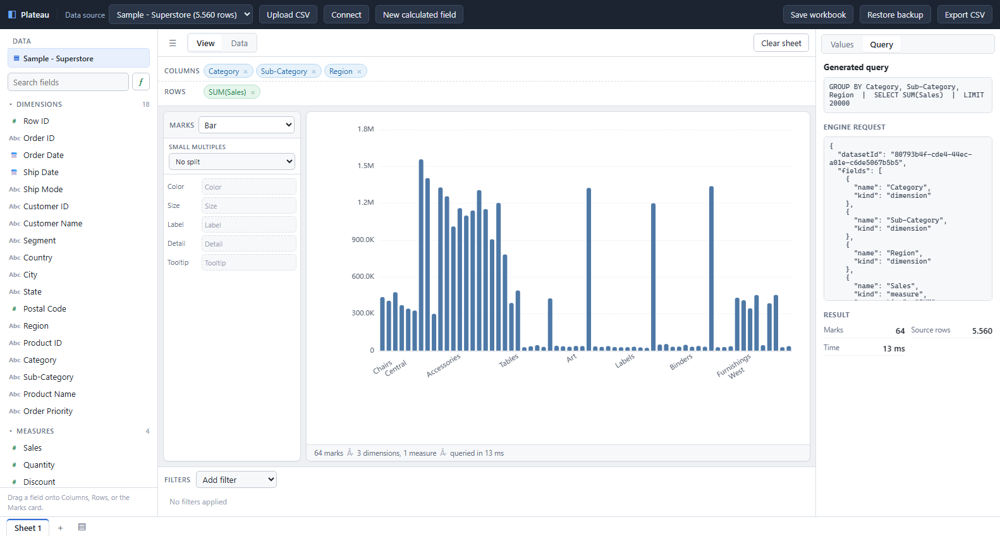

### Saving and loading

The workbook — every worksheet, its shelves and filters, and the dashboards — is
kept in `data/workbook.json` on the server.

- **Autosave** writes it about a second after each change, so a session survives a
  reload without being asked.
- **Save workbook** writes immediately, for when you do not want to wait — and says
  "Workbook is already saved" when autosave got there first rather than rewriting
  identical content.
- **Open saved workbook** replaces the current view with the last saved file. Loading
  is also what happens at start-up: the saved workbook is restored *after* the data
  source is loaded, which is the order that makes it stick.
- **Restore backup** swaps in the previous generation, so one bad save is
  recoverable. The current file becomes the next backup, so that is undoable too.

A save is skipped when the workbook is identical to the file, which keeps the
one-generation backup meaningful instead of rotating it with the same content on
every reload.

Everything above lives behind the **Workbook ▾** menu in the command bar, together
with the file actions.

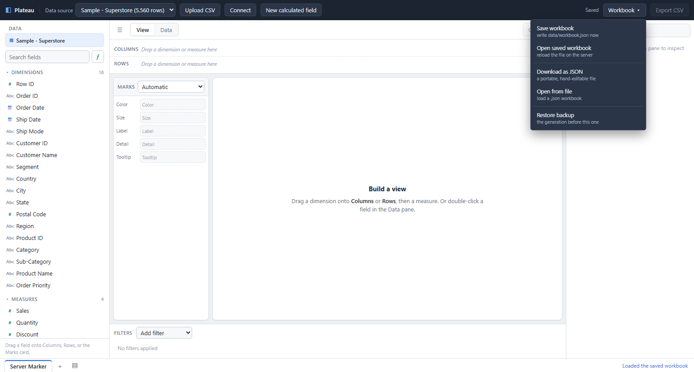

#### Workbook files

**Download as JSON** writes the workbook to a file; **Open from file** loads one.
That makes a workbook portable — keep it in version control, copy it to another
machine, or hand it to someone else.

The file is pretty-printed with a `formatVersion`, so it diffs and can be edited by
hand. The reader is deliberately forgiving: it accepts the exported object, the same
object without a version, a `{ "workbook": { … } }` wrapper, or a **bare array of
sheets**. Missing bits are filled in and reported as "adjustments" in the status
line rather than silently dropped; invalid JSON, an empty file, and a file from a
newer format are refused with a message and leave the current workbook alone.

A hand-authored test set is therefore just sheets — the smallest useful sheet names
one field:

```json
[
  {
    "name": "Sales by Region",
    "mark": "column",
    "shelves": {
      "columns": [{ "field": "Region" }],
      "rows": [{ "field": "Sales", "kind": "measure", "aggregation": "SUM" }]
    }
  },
  {
    "name": "Profit by Category",
    "shelves": {
      "columns": [{ "field": "Category", "kind": "dimension" }],
      "rows": [{ "field": "Profit", "kind": "measure" }],
      "color": [{ "field": "Segment", "kind": "dimension" }]
    }
  }
]
```

Optional per-sheet fields are `mark`, `paneBy`, `splitMeasures`, `palette`,
`filters`, and the usual shelf encodings (`aggregation`, `datePart`, `sort`,
`tableCalc`). Dashboard panels, `activeSheetId` and `view` are only needed if the
file should open on a dashboard. Opening a file also makes it the saved workbook, so
it survives a reload.

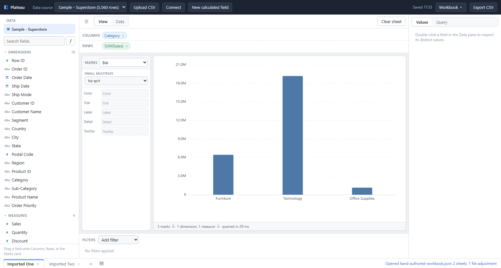

#### The starter test set

`workbooks/test-set.json` is a worked example and a smoke suite: 14 worksheets
covering every mark family, nested axes, small multiples, a table calculation, a
filter, a measure split, plus a dashboard. Open it with **Workbook ▾ → Open from
file** to click through them all.

`e2e/verify-test-set.mjs` opens that file and renders every sheet in it, asserting
each view is produced without an error. Extending the JSON extends the check — the
fixture *is* the test, so it can grow without the harness growing with it.

Many sheets also test the sheet-tab strip: tabs keep their width and truncate with a
tooltip, rather than shrinking until their names wrap, and the strip scrolls when the
list is wider than the window.

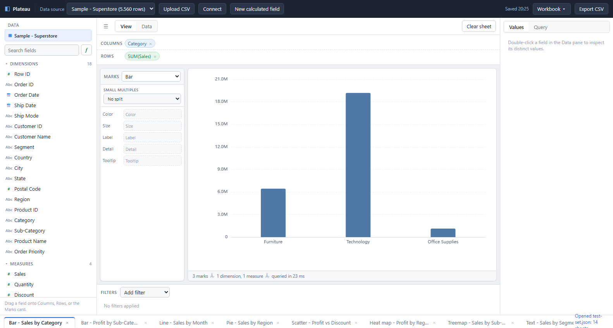

Each Marks-card channel does real work, and every mark type honours it:

| Channel | Effect |
| --- | --- |
| **Color** | A dimension splits marks into one series per value (stacked bars, one line per value, one colour per scatter group, a second treemap level). |
| **Size** | A measure scales scatter symbol area, area-scaled so visual weight matches the value. |
| **Label** | Prints each point's label on a scatter. |
| **Detail** | Adds the field to the query's grouping, which is how a scatter gets one point per member rather than a single grand total. A field as fine as a row identifier raises the grain to individual rows; the treemap refuses to draw that many tiles and says why. |
| **Tooltip** | Adds the field to the hover readout. |

Tooltips name the **full group path** together with the measure, so a value can never be
mistaken for a coarser total. A treemap tile reading `Tables / West` reports
`Sum of Sales: 435,910.85`, while the West region total is 7,564,832.16 — the old
tooltip showed a bare name and number, which made a sub-category value look like a
region total:

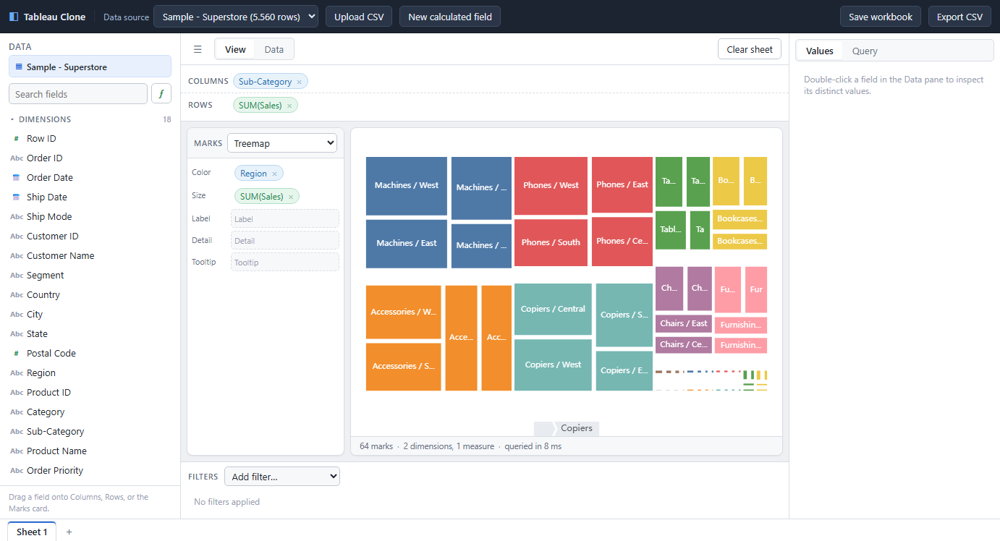

A scatter plot maps Columns to x, Rows to y, Color to series, Size to bubble area,
and Label to the text beside each point:

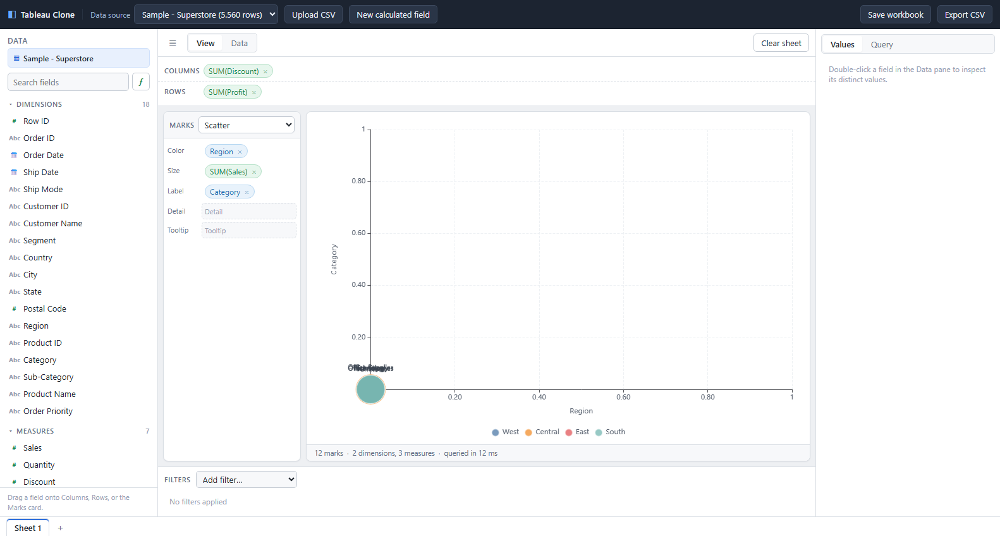

Color on a bar chart stacks the measures by the colour field. Note the axis tops out
at 21M — the *stacked* Technology total — rather than the 5.6M of a single region:

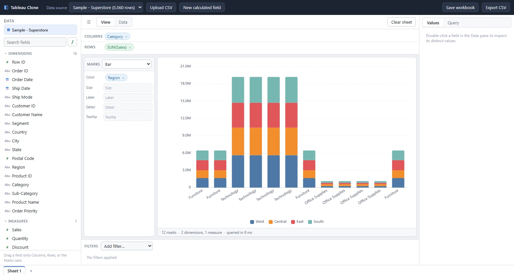

If the Map mark is chosen but the US geometry cannot be fetched, the view degrades to
a treemap with an explanation instead of failing:


### Dashboards

A dashboard composes worksheets onto a shared canvas. Create one with the ▤ button
next to the worksheet tabs, then add views from the toolbar.

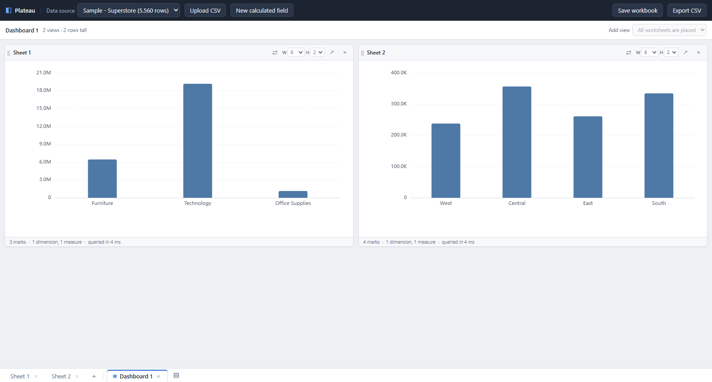

Each panel **runs its own query** and owns its loading and error state, so one slow or
broken worksheet cannot hold up the rest. The footer under every panel reports that
panel's own result, which is how the independence is visible.

Panels are laid out on a **fixed 12-column grid** carrying a column span and a row
span, rather than absolute pixel positions — so a dashboard reflows with the window
instead of needing to be repositioned. Per panel you get:

| Control | Effect |
| --- | --- |
| **W** | Width in grid columns (3–12) |
| **H** | Height in grid rows (1–6) |
| **⇄** | Swap position with the next panel |
| **↗** | Open that worksheet for editing |
| **×** | Remove from the dashboard |

The grid is why resizing is meaningful rather than cosmetic: a panel set to 12 columns
spans the full width, and 6 + 6 sit side by side.

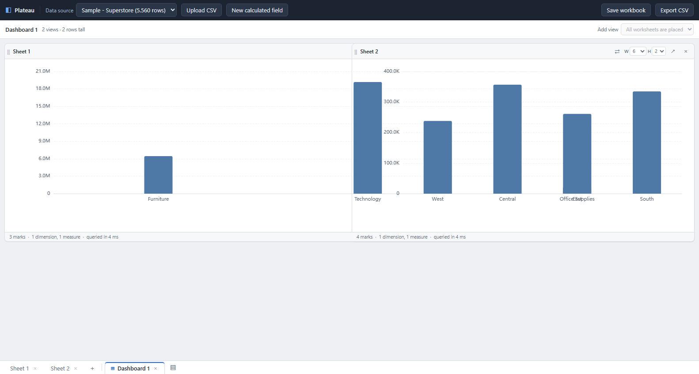

An empty dashboard explains what to do rather than showing a blank canvas:

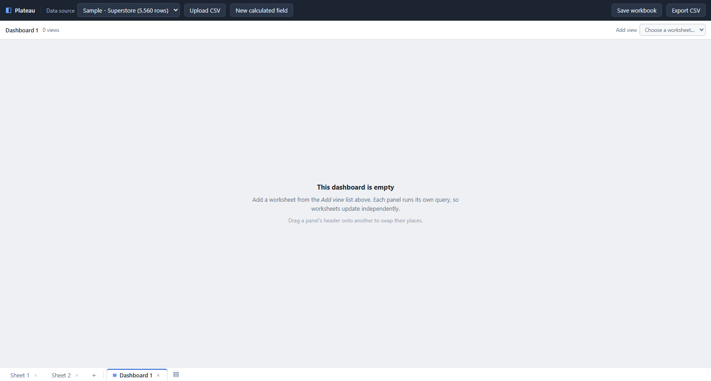

Deleting a worksheet removes its panels from every dashboard, so a dashboard can never
hold a dangling reference.

The inspector shows each field's statistics, or the exact engine request behind a view:

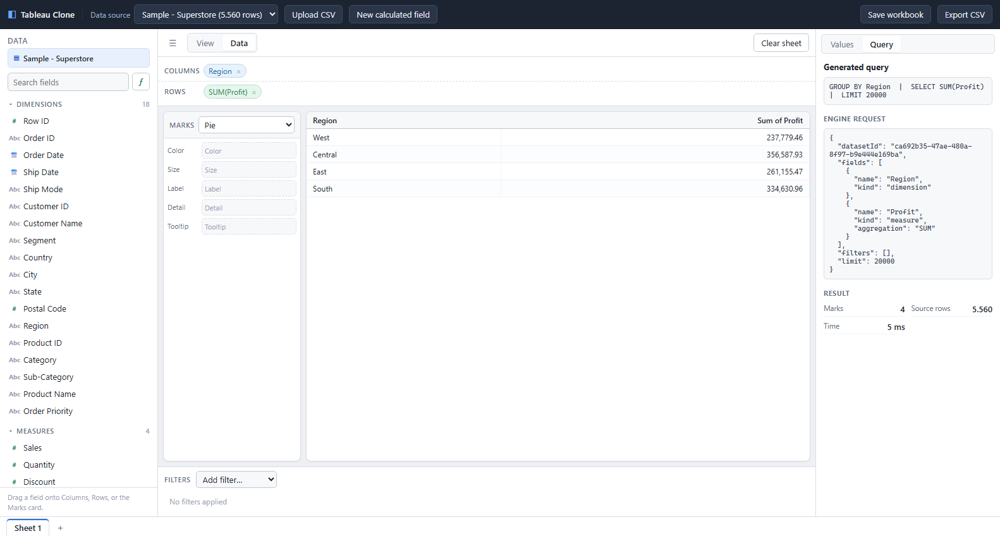

---

## Quick start

```bash
npm install
npm run seed     # writes data/superstore.csv (deterministic)
npm run dev      # API on :5177, UI on :5173
```

Then open **http://localhost:5173**.

To run the API and the built UI from a single origin instead:

```bash
npm run build
npm run serve    # http://127.0.0.1:5177
```

### Verifying it works

```bash
npm test         # 739 unit checks, 22 suites
npm run typecheck
npm run test:ui  # drives the real UI in headless Chrome; 41 end-to-end checks
```

`npm test` runs twenty-two suites: `engine.test.ts` (expressions, CSV, inference, query
execution, calculated fields), `lod.test.ts` (parsing, dimension resolution, filter
ordering), `protocol.test.ts` (local/remote parity, wire shapes), `httpTransport`,
`remoteDataset`, `queryValidation` (unknown field names are refused),
`capabilityGating` (filter operators, scopes and formula vocabulary),
`workbookBackup`, `tableCalcs`, `split`, `axisSelection`, `aggregationMenu`,
`workbookFile`, `calculationDrafts` (calculation identity, dataset binding,
re-registration), `referenceLines` (value axis, orientation, marks without one),
`bins` (bin arithmetic, validation, suggestions, offered fields),
`setsGroups` (set filter identity and refresh, group formulas, offered fields),
`nullCells` (absence is not zero, in every mark), `markInference`,
`axisNesting` (line, heat map and treemap show every placed dimension),
`engineAuth` (login, bearer tokens, 401) and `join`. LOD and engine tests use a small
hand-computable fixture so every expected number can be checked by arithmetic rather
than by trusting the implementation.

`npm run test:ui` needs the app running and Chrome installed; it writes screenshots
to `.tmp/`. Inside the DSH sandbox it also needs the wider sandbox mode — headless
Chrome cannot start without it (see [ENVIRONMENT.md](ENVIRONMENT.md)). It asserts on
rendering, not just HTTP status: that an ECharts canvas appears, that pills land on
the right shelves, that filters change results, that nested axis labels carry every
placed dimension, and that the browser console stays clean.

The other harnesses, each of which prints `N passed, M failed`:

```bash
node e2e/verify-lod.mjs        # 14 checks: LOD fields through the real UI, incl. filter ordering
node e2e/verify-marks.mjs      # 29 checks: Color / Size / Label channels, bar stacking, reference lines
node e2e/verify-viz.mjs        # 27 checks: scatter axes, trend-line fit, heat map orientation
node e2e/verify-sort.mjs       # 15 checks: Sort control reaches the engine; axis orientation
node e2e/verify-treemap.mjs    # 16 checks: treemap hierarchy, tooltip paths, Detail guard
node e2e/verify-dashboard.mjs  # 29 checks: panels, independent queries, resize, swap, persistence
node e2e/verify-connect.mjs    # 80 checks: connect dialog, capability gating, pushed-down fields, null cells, filter scopes
node e2e/verify-tablecalc.mjs  # 14 checks: table calculations in the real UI
node e2e/verify-split.mjs      # 16 checks: split panes
node e2e/verify-measuresplit.mjs # 26 checks: one pane per measure
node e2e/verify-retry.mjs      # 13 checks: a failed query is recoverable
node e2e/verify-workbook.mjs   # 97 checks: save, start-up restore, menu, JSON files, calculation drafts across a restart, bins, sets and groups
node e2e/verify-test-set.mjs   # 28 checks: opens workbooks/test-set.json, renders every sheet, checks the tab strip
node e2e/verify-join.mjs       # 38 checks: joins against the real engine; skips without it
node e2e/verify-auth.mjs       # 45 checks: authRequired gate, login, bearer on every call, expiry re-sign-in, no token in the browser
node e2e/capture-marks.mjs     # regenerates heat map / waterfall / scatter screenshots
```

Total: **1269 checks** — 739 unit, 530 browser.

| Unit suite | Checks | Covers |
| --- | --- | --- |
| engine | 77 | expressions, CSV, type inference, query execution, calculated fields |
| LOD | 45 | `FIXED`/`INCLUDE`/`EXCLUDE` parsing and filter ordering |
| protocol | 56 | **local/remote parity**, wire shapes, LOD fallback, capability negotiation |
| http transport | 35 | request encoding, error mapping, timeouts, doc/code consistency |
| remote dataset | 38 | registration, failure modes, queries, pushed-down calculated fields |
| query validation | 17 | unknown field names are refused, local and remote |
| capability gating | 43 | filter operators, per-scope reports, row caps, formula vocabulary |
| table calculations | 51 | partitions, addressing, null handling |
| workbook backup | 14 | rotation, restore, corruption |
| split | 35 | partitioning, ordering, refusals |
| axis selection | 34 | dimensions beat measures; nesting to any depth |
| capability menus | 29 | aggregations, filter operators and per-scope lists, never lying about the current value |
| workbook file | 67 | round trip, hand-authored files, refusals, repairs, calculation drafts, reference lines, sets |
| calculation drafts | 23 | identity, dataset binding, missing-on-server planning |
| reference lines | 11 | value axis, horizontal orientation, marks without a value axis |
| bins | 30 | bin arithmetic evaluated per row, width validation, suggestions, offered fields |
| sets and groups | 27 | filter identity and refresh, group formulas evaluated, offered fields |
| null cells | 22 | absence is not zero, in every mark |
| mark inference | 7 | a scatter needs a measure on each axis |
| axis nesting | 20 | line, heat map and treemap show every placed dimension |
| engine auth | 30 | public capabilities, login, per-request bearer tokens, 401 drops the session |
| joins | 28 | join schema, gating, capability refusal |

Both browser and transport suites run against the real thing — a loopback HTTP
server and a real server process — rather than mocked fetches, so the parts that
only exist over a network are genuinely exercised. The harnesses clean up after
themselves; see `e2e/harness.mjs`.

`verify-viz.mjs` recomputes the least-squares fit independently in the browser and
compares it to the one the renderer drew, so a broken trend line cannot pass.
`verify-connect.mjs` runs a stub engine that answers a query by echoing its shape,
so a pushed-down calculated measure arriving as a bare aggregation would fail the
check rather than hide behind a canned response. `verify-workbook.mjs` downloads a
real file and opens a hand-written one through the hidden file input, so the JSON
round trip is exercised as a browser would do it, not in-process.
`verify-test-set.mjs` opens `workbooks/test-set.json` and visits every worksheet in
it, so the spreadsheet-shaped fixture is itself the UI smoke suite.

---

## Architecture

```
src/core/          the in-memory database — zero runtime dependencies
  types.ts         column/table schema, dimension vs measure semantics
  csv.ts           RFC 4180 parser + delimiter sniffing
  table.ts         columnar construction and type inference
  aggregations.ts  single-pass aggregation statistics
  filters.ts       row-level and aggregate-level predicates
  expression.ts    tokenizer, parser, and evaluator (incl. LOD syntax)
  lod.ts           level-of-detail execution: grouping, filter ordering
  engine.ts        query planner and executor
src/server/        thin HTTP layer over the engine
  store.ts         in-memory datasets, calculated fields, previews
  api.ts           REST endpoints
src/web/           React UI
  viewModel.ts     sheets, dashboards, shelves, pills -> engine query
  chartSpec.ts     query result -> ECharts option (pure function)
  useAppState.ts   dataset + workbook state and dashboard editing
  useSheetQuery.ts runs one worksheet's query (used per dashboard panel)
  components/      DataPane, Shelf/Pill, MarksCard, FiltersPanel, ChartView,
                   DashboardView, DashboardPanelView, ViewErrorBoundary, ...
scripts/           seed generator + toolchain shims + test runner
e2e/               headless-browser verification harnesses
```

The layering is strict: `core` knows nothing about HTTP or the DOM, so the whole
engine is testable in isolation and could be reused in a worker or a CLI.

### How a view becomes data

```
shelf pills  ->  QuerySpec          (viewModel.ts)
                 { fields, filters, limit }
             ->  planner + executor  (engine.ts)
                 prune rows, group, aggregate, sort, limit
             ->  QueryResult
                 { columns, rows, metadata }
             ->  ECharts option      (chartSpec.ts)
```

Measures are addressed by their pill label (`Sum of Sales`), which is how the
renderer locates a series without re-deriving the query.

---

## API

| Method | Path | Purpose |
| --- | --- | --- |
| `GET` | `/api/health` | Liveness and dataset count |
| `GET` | `/api/datasets` | List datasets with schemas |
| `POST` | `/api/datasets` | Upload a CSV (multipart) |
| `POST` | `/api/datasets/paste` | Create from pasted delimited text |
| `DELETE` | `/api/datasets/:id` | Drop a dataset |
| `GET` | `/api/datasets/:id/preview` | Paged raw rows |
| `GET` | `/api/datasets/:id/domain` | Distinct values for a field |
| `POST` | `/api/datasets/:id/calculated` | Create a calculated field |
| `DELETE` | `/api/datasets/:id/calculated/:name` | Remove a calculated field |
| `POST` | `/api/query` | Execute a query |
| `GET`/`PUT` | `/api/workbook` | Load / save workbook state |
| `GET` | `/api/workbook/backup` | Read the previous workbook generation |
| `POST` | `/api/workbook/restore` | Swap the current workbook for that generation |

A query naming a column the dataset does not have answers `400` with
`{ "error": "Unknown field \"X\": …", "code": "unknown_field" }` rather than a
column of nulls.

Example query:

```jsonc
POST /api/query
{
  "datasetId": "…",
  "fields": [
    { "name": "Category", "kind": "dimension" },
    { "name": "Sales",    "kind": "measure", "aggregation": "SUM" }
  ],
  "filters": [
    { "id": "f1", "field": "Region", "scope": "dimension",
      "operator": "in", "values": ["West"] }
  ],
  "sort": { "field": "Sum of Sales", "direction": "desc" },
  "limit": 1000
}
```

---

## Environment notes

This project was built inside the DSH sandbox, which imposed three non-obvious
constraints. They are documented in [ENVIRONMENT.md](ENVIRONMENT.md) because the
workarounds are load-bearing:

1. **pnpm must use a hoisted `node_modules`.** Node does not follow Windows directory
   junctions during module resolution, which silently breaks pnpm's default isolated
   layout (Vite cannot find its own transitive dependencies).
2. **The server runs on plain Node, not `tsx`.** `tsx` drives esbuild, which spawns a
   child process with piped stdio — blocked by the sandbox. Node 24's native
   type-stripping is used instead, with `scripts/ts-resolve.mjs` mapping `.js`
   specifiers onto `.ts` sources.
3. **Vite and headless Chrome need the wider sandbox**, since both spawn child
   processes. Vite also needs `TEMP` pointed at a workspace-local directory.

If you clone this outside DSH, `npm install && npm run dev` works with none of this;
you can also swap the `scripts/run.mjs` invocations for `tsx` if you prefer.

Two environment knobs are useful when running the browser harnesses:

- **`PLATEAU_DATA_DIR`** points the server at a different data directory (sample,
  saved workbooks, uploads), so a harness can own an isolated one instead of
  scribbling over `data/workbook.json`. `verify-workbook.mjs` does exactly that.
- **The app restores its saved workbook at start-up**, which is the point of it —
  so a harness that assumes a blank app will inherit whatever was last saved.
  `resetWorkbook()` in `e2e/harness.mjs` starts a run blank and puts the previous
  workbook back on teardown; every shared-server harness calls it.

---

## Native engine protocol

Plateau can drive a remote analytics engine **without SQL**. The client sends a
*plan*; the engine owns every physical decision.

```
viewModel --QuerySpec--> specToRequest() --QueryRequest--> engine
                              |
result  <--toQueryResult()--- QueryResponse
```

The split is deliberate and load-bearing:

| Concern | Owner |
| --- | --- |
| Column types, cardinality, null counts | **engine** — it knows |
| Aggregation math, scan strategy, pushdown | **engine** |
| Is "Postal Code" a dimension or a measure? | **client** — it is presentation policy |
| Which aggregations the UI offers | **client**, filtered by `capabilities()` |

Keeping policy out of the engine is what lets it serve other clients later without
change. `src/core/protocol.ts` is the contract; `src/server/dataSource.ts` holds
the two implementations.

### Two backends, one interface

`DataSource` splits metadata from data, because a remote engine may hold far more
than can be materialised:

1. `schema()` — metadata only. Enough for the data pane, and all most interactions need.
2. `sample()` — a bounded slice, for the preview grid and value lists.
3. `query()` — compute a result. The pushdown target.

- **`LocalBackend`** wraps the in-process engine. Behaviour-preserving; every
  existing check runs through it.
- **`RemoteBackend`** speaks the protocol. It never materialises the dataset
  except in `materializeTable()`, which exists solely for the client-side LOD
  fallback and is bounded by `maxRows`.

### Capability negotiation, not optimism

An engine that cannot compute LOD semantics must not be trusted with them —
`RemoteBackend` detects this from `capabilities()` and computes those formulas
locally instead of silently returning wrong numbers.

The rest of the report drives the UI, list by list, carried to the browser in the
dataset metadata:

| Report | Governs |
| --- | --- |
| `aggregations` | The pill editor's aggregation menu |
| `filterOperators` | Which filter dialogs and modes the filter shelf offers |
| `filterOperatorsByScope` | The same, refined per scope — the two scopes prune rows vs rank aggregates, so an engine may support one and not the other |
| `expressionFunctions` | Which formula functions the editor offers, and whether a calculated field may be pushed down at all |
| `supportsJoin` | Whether the connect dialog offers an attribute join |
| `supportsInlineDomain` | Whether filter value lists travel with the query; `false` falls back to a bounded sample |
| `maxRows` | The cap on every requested limit, including a materialisation, which is refused rather than truncated |

A value already saved in a workbook that the engine lacks stays visible and
labelled — an aggregation reads `(unsupported)`, a filter chip says "not supported by
this data source" — so a menu never lies about the current view. A filter using an
operator the engine does not implement is also refused server-side as
`unsupported_filter`, because a workbook can be saved against one engine and opened
against another.

`expressionFunctions` lists **plain function calls only** (`ZN`, `IFNULL` on the
reference engine). Aggregates are reported by `aggregations`, and `IF` is an AST
*node* — it needs no entry, and requiring one would refuse a formula the engine runs.

**"Not reported" is not "nothing works".** An absent list means the engine did not
say, and everything is offered; only a report gates. One exception is deliberate:
an EMPTY `expressionFunctions` list means "no expression evaluator", and refuses
pushed-down formulas outright, because every expression uses at least one function.

**What this deliberately does not do:** there is no SQL anywhere in this path, and
no dialect handling. `specToRequest` is the only place the two vocabularies meet.
The engine's own `/sql` console is debugging tooling, not part of this contract.

### Calculated fields on a remote engine

Only **aggregate-bearing** formulas can be pushed down. `SUM([Profit]) /
SUM([Sales])` has no per-row value, so it travels as a parsed AST and the **engine**
evaluates it:

```json
"measures":   [{ "name": "Margin", "expr": { "type": "binary", "op": "/", … } }],
"expressions": { "Margin": { "type": "binary", "op": "/", … } }
```

The client validates the formula against the engine's report before creating it, and
refuses with a specific reason:

- an aggregation the engine does not advertise in `aggregations`;
- a function it does not advertise in `expressionFunctions`;
- **two aggregations of the same field** (`SUM([x]) / AVG([x])`) — the engine allows
  one aggregation per field per expression;
- row-level formulas (a remote engine has no rows) and LOD expressions (a second
  query, not an expression).

An engine with no expression evaluator (`expressionFunctions: []`) refuses all
calculated fields at creation, instead of accepting one that fails on its first
query. When the engine does evaluate, the client must **not** also compute the
formula: two evaluators will disagree, silently.

Semantics the UI surfaces rather than papers over: division by zero is **absent**,
an absent input makes the result absent (that is what `ZN`/`IFNULL` are for), and an
absent `IF` condition is absent rather than the `ELSE` branch.

### Absent values are `null`, never zero

A group with no data comes back as `null`, and absence is not a measurement:

- charts draw a **gap** — no bar, a break in a line, an empty heat-map cell;
- tooltips show an em dash (`—`);
- tables show an **empty cell**, and CSV an empty field;
- a view where *every* group is absent says so instead of drawing empty axes.

Nothing gets coerced to zero: a zero bar would be a claim about the data that the
engine never made. Table calculations and trend lines skip nulls rather than treating
them as zeros — a trend line fitted through `(0, 0)` looks reasonable and is wrong.

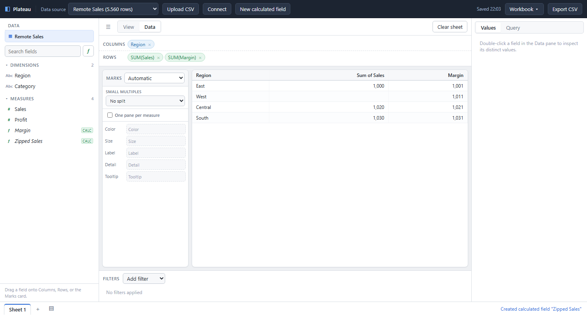

---

## What's done and what's next

### Done

- In-memory engine, 14 mark types, calculated fields, LOD expressions
- Dashboards on a shared grid
- Native engine protocol: remote datasets, joins, and aggregate calculated fields
  pushed down as ASTs — **evaluated by the engine**, with the client validating the
  formula against the engine's own capability report
- The capability report is fully consumed: aggregation and function lists gate the
  menus, filter operators are per scope where reported, requested limits are clamped
  to `maxRows`, and an engine without inline domains gets a bounded-sample fallback
  instead of an empty filter list
- Line, area, heat-map and treemap marks nest every placed dimension, on top of the
  bar-like marks that already did; heat maps nest per shelf (Columns across, Rows
  down) and a treemap turns every placed dimension into a hierarchy level
- Absent measure cells kept distinct from zero everywhere: charts, tooltips, tables,
  CSV, table calculations
- **Engine authentication**: feature-detected via public `capabilities.authRequired`,
  a sign-in gate in the connect dialog, and a server-held bearer token attached per
  request — so a re-login is picked up by already-registered datasets, and a 401
  asks for a sign-in and retries once instead of storming
- Workbook autosave with a restorable previous generation, and portable JSON
  workbook files for keeping, sharing or hand-authoring test sheets
- **Calculation drafts live in the workbook.** The engine evaluates formulas but stores
  nothing, and the Plateau server keeps them only in memory, so the definitions are
  saved alongside the sheets and re-registered when a dataset is activated — a server
  restart no longer loses calculated fields. They remain explicitly local drafts, not
  shared model objects.
- **Reference lines** annotate a chart's value axis (a target, budget or average)
  without changing the query: bar family, line and area, with the line moving to x
  for horizontal bars and the control hidden where a mark has no value axis.
- **Bins** group a numeric measure into equal-width ranges through a small dialog that
  writes an ordinary calculated dimension (`FLOOR([Sales] / 1000) * 1000`) and shows
  the formula and range before creating it. Local datasets only: a remote engine does
  not expose the rows a row-level formula needs.
- **Sets** are named member selections saved in the workbook and applied as ordinary
  dimension filters ("In" / "Out"), so they work on remote data too, and filters that
  came from a set follow its membership when it is edited. **Groups** combine selected
  members into a derived dimension, produced as a row-level calculated field with the
  IF formula shown up front (local-only, like any row-level field).
- A 14-sheet starter test set that renders every mark family, checked sheet-by-sheet
  in the browser
- 1269 checks green (739 unit, 530 browser)

### Connecting to an engine

`RemoteBackend` needs a transport. `HttpEngineTransport` speaks the wire format in
[`docs/ENGINE-PROTOCOL.md`](docs/ENGINE-PROTOCOL.md) over HTTP/JSON:

```ts
const transport = new HttpEngineTransport({
  baseUrl: 'http://127.0.0.1:8080',
  timeoutMs: 30_000,
});
```

Three routes expose this to the browser:

| Route | Purpose |
| --- | --- |
| `GET /api/engine/probe?url=` | Reports capabilities and reachability without registering anything |
| `POST /api/datasets/remote` | Registers a dataset held by an engine |
| `GET /api/datasets` | Remote datasets appear alongside local ones |

An unreachable engine returns `reachable: false` rather than an HTTP error — a
server being down is a normal answer to "is it up?", not a fault. Errors that do
surface keep their protocol code (`unknown_dataset`, `unsupported_aggregation`, …)
so a caller bug stays distinguishable from an engine fault.

The transport is deliberately re-implementable: `EngineTransport` is four methods,
and the tests drive a real loopback HTTP server rather than mocking `fetch`, so
request encoding, status handling and timeouts are genuinely exercised.

### Connecting from the UI

**Connect…** in the command bar opens the connection dialog.

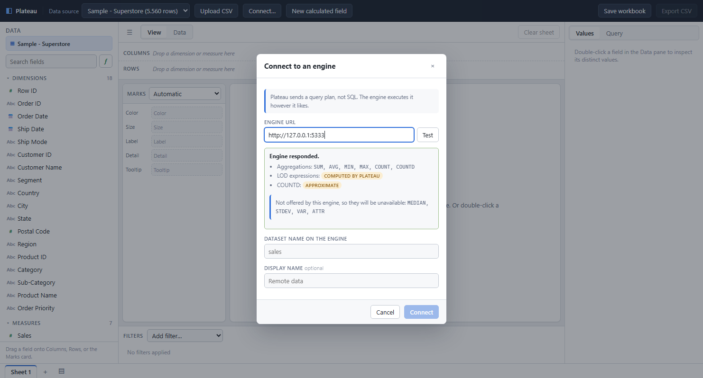

The flow is probe-then-connect rather than a single submit, so you learn whether
the engine is up and what it can actually do *before* committing:

- **Test** reports reachability and the engine's capabilities. An unreachable
  engine is rendered as information, not an error — a server being down is a
  normal answer to "is it up?".
- **Capability reporting is specific.** An engine without LOD support says
  `COMPUTED BY PLATEAU` rather than looking identical to one that has it, and an
  approximate `COUNTD` is labelled as such.
- **Unsupported aggregations are named up front**, so a missing feature reads as
  "this engine does not do that" rather than "this is broken" — and once connected
  the pill editor offers only what the engine implements.
- **The filter shelf follows the same rule**: a categorical filter offers Include but
  not Exclude when the engine lacks `notIn`, and a numeric filter offers only the
  modes the engine implements — or says plainly that it implements none.
- **Calculated fields work on the remote dataset** when the formula aggregates
  (`SUM([Profit]) / SUM([Sales])`) and the engine can evaluate its functions;
  row-level formulas, LOD formulas and unimplemented functions are refused in the
  dialog with the reason.
- **Connect** registers the dataset, which then behaves like any other data
  source — fields in the pane, drag onto shelves, charts render.

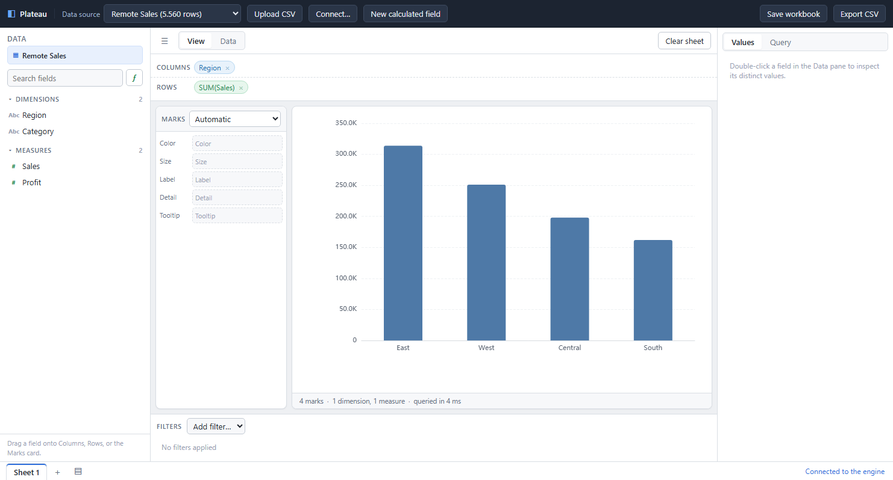

A calculated field on a remote dataset is pushed down as an AST rather than
computed client-side:

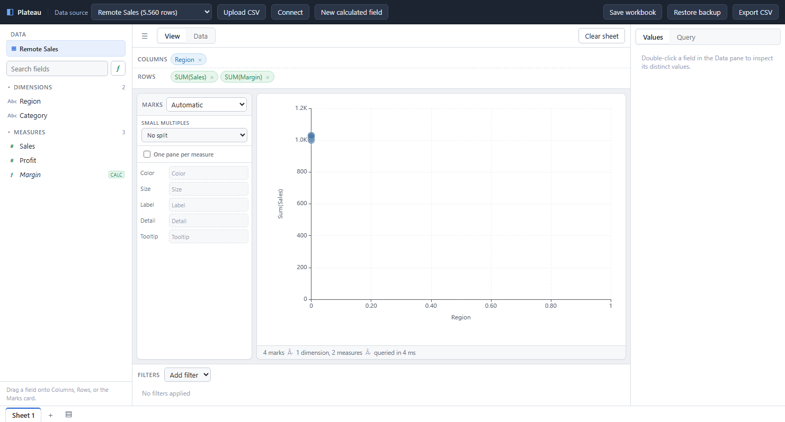

Everything upstream is unchanged: the query travels as a plan, the engine
executes it, and the client renders what comes back.

### Engine authentication

An engine may require a bearer token. Nothing about that is assumed: capabilities is
public and carries `authRequired`, and only `POST /v1/login` and
`GET /v1/capabilities` are reachable without a token.

- **Feature-detected, not guessed.** `authRequired: true` makes the connect dialog
  show a sign-in gate before it lists cubes or fires any data request; `false` means
  development mode (`--allow-anonymous`); an ABSENT field (an older engine) is read
  as `false`, so a Plateau build keeps working across the upgrade.
- **The token stays on the Plateau server.** The browser never receives it: login
  goes through `POST /api/engine/login`, the token is held in memory keyed by engine
  URL, and the transport resolves it per request — so a re-login is picked up by
  already-registered datasets without re-registering them.
- **Wrong user and wrong password are one message** ("Invalid user name or
  password."), by the engine's design, and Plateau shows it verbatim.
- **A dead session asks for a sign-in, once.** Any 401 — expiry, engine restart,
  revocation — drops the stored token and opens a re-sign-in dialog aimed at that
  dataset's engine; signing in retries the failed query exactly once. There is no
  automatic retry loop.
- **Roles are shown, not enforced.** They are informational until the engine's
  permissions work lands; users are created with the engine CLI
  (`serve.exe --add-user alice --role reader`), never through Plateau.
- **The engine's SQL console is not linked**: its page has no token field yet, so
  `POST /v1/sql` would 401.

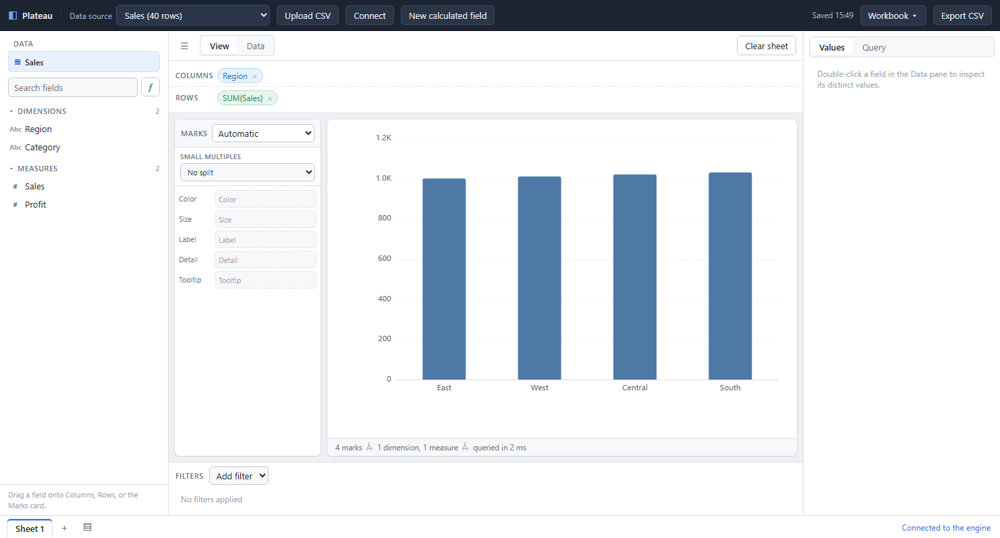

Development without auth: start the engine with `-Anonymous` (or
`serve.exe --allow-anonymous`) and `authRequired` reports `false`. A browser
speaking to the engine directly also needs CORS (`-Cors`), because the `Authorization`
header triggers a preflight the engine must allow.

### The remote backend, piece by piece

- `src/core/protocol.ts` — versioned contract, validation, typed errors
- `src/server/dataSource.ts` — `DataSource`, `LocalBackend`, `RemoteBackend`
- 48 new checks, the important one being **local/remote parity**: the same query
  through both paths is compared value for value, so the protocol cannot silently
  lose information
- **`store.ts` migrated onto `DataSource`** — a dataset is now a backend plus its
  calculated fields, and every API route runs through the backend rather than
  reaching for a `DataTable`. `RemoteBackend` is therefore reachable from the API.
- **`HttpEngineTransport`** — the concrete transport, with typed errors, per-request
  timeouts, and a conservative capability fallback for engines that do not
  implement `capabilities`.
- **`POST /api/datasets/remote`** — registers a dataset served by an engine, so a
  remote dataset is usable from the browser.
- **Connect dialog** — probe, capability reporting, and registration in the UI.
  A remote dataset is then indistinguishable from a local one: drag fields, build
  charts, add it to a dashboard.
- **Capability-driven menus** — the engine's aggregation list travels in the dataset
  metadata to the browser and drives the pill editor, so an aggregation the engine
  does not implement is not offered.
- **Calculated fields pushed down** — an aggregate formula is registered on the
  backend, listed in the data pane, and sent as `{ name, expr }` with the AST in
  `expressions`. The engine evaluates it; the client validates the formula's
  aggregations, its function calls and its "one aggregation per field" rule first,
  and refuses row-level and LOD formulas with the reason.
- **Unknown field names refused** — `POST /api/query` names the offending field and
  answers 400 instead of returning a column of nulls.
- **Capability gating for filters and formulas** — `filterOperators` drives the filter
  dialogs and is enforced server-side as `unsupported_filter`; `expressionFunctions`
  drives the formula palette and is checked against a pushed-down formula's calls.
  `IF` is treated as an AST node, not a gated function.
- **Absent values are not zero** — a `null` measure cell is a chart gap, an em dash
  in a tooltip, an empty table cell, and an exclusion from table calculations and
  trend-line fits. 22 unit checks and 13 browser checks pin it.
- 122 new checks across the protocol, transport, registration and dialog paths.
  The load bearing one is **local/remote parity**: the same query through both
  backends is compared value for value, so the protocol cannot silently lose
  information.

### Next

1. **Row-level and LOD calculated fields on a remote engine.** An aggregate formula
   has a value per group; `[Profit] / [Sales]` has one per source row, and the engine
   exposes no rows. What it needs is an engine-side row-expression evaluation, or
   `sample()` plus client-side materialisation with the formula appended as a real
   column (the local path already does the second half). Until then both are refused
   with a typed error rather than registered as columns that evaluate to null, and
   **bins** — which are a row-level calculated dimension — remain local-only.
2. **Only one aggregation per field** is allowed inside a pushed-down expression by
   the engine. The client refuses the second one with an explanation, but a
   higher-order expression (e.g. a ratio of two aggregates of the same column) still
   needs a separate calculated field or an engine change.
3. **The rest of `capabilities()`.** `countDistinctExact` only labels `COUNTD` in the
   connect dialog. The per-scope filter report is implemented client-side but the
   reference engine does not send it yet, so that negotiation is untested against
   the real engine. `maxRows` and `supportsInlineDomain` are now consulted.
4. **Roles are informational.** Authentication works end to end, but the engine's
   permissions work (its S2) is not here: every signed-in user sees the same data,
   and Plateau only displays the role list. A token-revoke endpoint and a token field
   on the engine's SQL console are also engine-side.
5. **Then** forecasting, the remaining higher-value analytics gap. Ranked in
   *Known limitations*.

### A note on calculated fields

They are a client concept — the formula is authored in Plateau's syntax and the
workbook owns it — so the store chooses a strategy per backend:

- **Row-level** formulas are evaluated per row and appended as a real column.
- **Aggregate-bearing** formulas, LODs included, cannot exist per row. On a local
  dataset they are still appended as a column, deliberately holding nulls, because
  the planner discovers LODs by walking the table schema for `isCalculated` entries
  carrying a formula. Registering them as metadata only left `scanLodDependencies`
  unable to resolve a reference like `[RegionTotal]`, and the LOD silently evaluated
  to null — a real bug hit during the store migration and caught by the LOD suite.
- **Pushed down** (remote backend) — only aggregate-bearing formulas qualify. The
  AST travels in the query's `expressions` map, a measure naming the field carries
  `expr` instead of `aggregation`, and the schema entry is synthesised client-side
  because the engine's catalog cannot know about a field the client defined. The
  engine evaluates the AST; the client validates it against `capabilities` and does
  not evaluate it a second time.

---

## Known limitations

Deliberately out of scope for this build, and the honest next steps:

- **Joins are structural, not arbitrary.** One join per dataset, LEFT only, keyed on a
  conformed dimension; no arbitrary predicates, no data blending across sources, no
  cross-source calculation.
- **Engine sessions live in the Plateau server's memory.** A Plateau restart, or an
  engine restart, means signing in again; there is no refresh token and no
  server-side logout endpoint yet (dropping the token is the whole sign-out). Signed-in
  users all see the same data until the engine's role permissions land.
- **Calculated fields on a remote engine are aggregate-only**, one aggregation per
  field, and only when the engine advertises an expression evaluator. Row-level and
  LOD formulas are refused with an explanation; the engine exposes no rows for them
  to run against. **Bins and groups are row-level calculated dimensions, so they are
  local-only for the same reason** — on a remote dataset the controls are disabled
  with that explanation rather than producing fields that would evaluate to null.
- **Sets are saved filters, not a shelf member.** Applying one adds an ordinary `in` or
  `notIn` dimension filter, so there is no "IN/OUT of set" pill to colour by and no set
  actions; a filter that came from a set follows the set's membership when it is edited,
  but keeps working if the set is later deleted (the values are copied). **Groups are a
  generated calculated field**: they cannot be re-edited through the group dialog; edit
  the formula instead.
- **Calculations are client-side conveniences, not model objects.** Plateau authors
  them, pushes the AST per query, and the engine forgets it afterwards. The formula is
  kept as a **workbook draft** and re-registered after a server restart (the server's
  own copy is in-memory only), but it is not in the engine, so another front-end cannot
  see it, and it belongs to the active workbook/dataset — switching datasets starts a
  fresh workbook, as the sheets do. Stored calculations are a *reserved, unimplemented*
  contract in [`docs/ENGINE-PROTOCOL.md`](docs/ENGINE-PROTOCOL.md); the blockers are
  engine-owned (cross-dimensional reference semantics, measure vs member, and a write
  path).
- **Absent values cannot be distinguished from absent values on a remote engine
  only by chance.** The engine reports a group with no cells as `null`; Plateau never
  turns that into zero, but it also cannot show a null in a pie slice or a treemap
  tile — those encodings have no way to draw absence, so the group is omitted.
- **Filter capability is reported per scope, but only if the engine says so.** The
  wire contract gained an optional per-scope operator report; the reference engine
  does not report it yet, so Plateau falls back to its global list. An engine that
  reports it gets scope-accurate dialogs and refusals; one that does not is treated
  exactly as before.
- **Nesting reaches every mark with a hierarchy.** Bar-like, line/area and heat-map
  marks show every PLACED dimension (heat map nests per shelf — Columns across, Rows
  down), and a treemap turns every placed dimension into a hierarchy level. The text
  mark is a flat DOM grid that shows every dimension as its own column rather than a
  cross-tab.
- **Dashboards use a snapping grid, not a free-form canvas.** Panels carry column and
  row spans; there is no pixel positioning, overlapping, floating text, or
  cross-panel filtering. Dragging a header to swap positions is best-effort — the
  explicit ⇄ control is the reliable route, because React's `dragstart` handler does
  not fire for the panel header in every browser.
- **`COUNTD`/`MEDIAN`/`STDEV` use exact algorithms**, not HyperLogLog or t-digest, so
  they are O(n) per group rather than approximate. Fine at this data size, not at a
  billion rows. The same applies to LODs, which are computed per query with no
  materialised cache.
- **No extracts or indexing.** Everything is a full in-memory scan per query; the
  engine has no materialised views or column indexes beyond precomputed min/max.
- **LOD dimensions must be field references.** Tableau allows expressions such as
  `{ FIXED DATETRUNC('month', [Order Date]) : SUM([Sales]) }`; here the dimension list
  accepts `[Field]` only. Work around it by creating a calculated field for the
  expression and using that.
- **Nested LODs** parse and are registered, but the grouping semantics of an LOD
  inside another LOD's body are not meaningfully defined yet.
- **No geographic maps.** Deliberately withdrawn: a map needs vendored GeoJSON, a
  network round trip, and US-state-only data to be useful. Scatter and heat map
  cover the comparison work more directly.
- **Maps are absent rather than hidden.** The `map` mark and its GeoJSON loader have
  been removed from the codebase, not merely omitted from the dropdown.
- **Workbook autosave is single-user** and stored as one JSON file on the server;
  there is no concurrency control or versioning, and only one backup generation.
- **Workbook files carry sheets, not data.** Opening a `.json` workbook assumes the
  same data source names are present; a sheet referencing a field the active dataset
  does not have fails its query with the unknown-field error rather than being
  repaired. Hand-authored sheets are validated for shape, not against a dataset.
